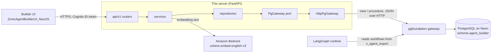
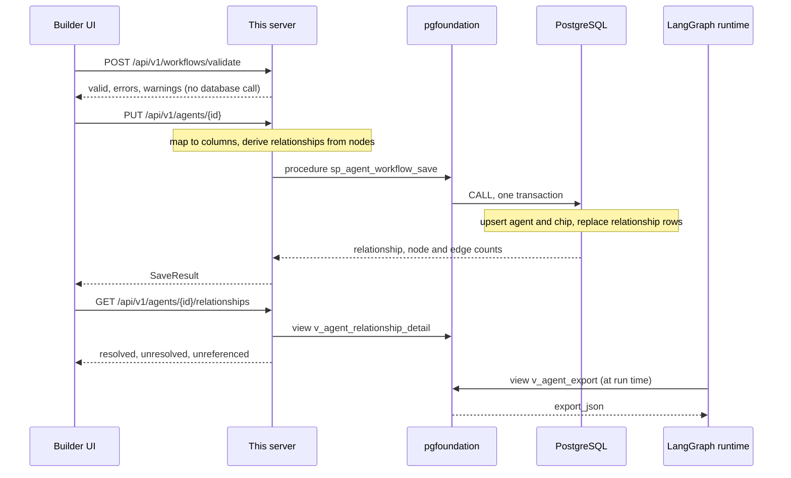

# Technical design: Zonic Agent Builder — Server (FastAPI)

How this repository is built. Setup, commands and the hackathon summary are in the [README](../README.md).

This server is the write side of the platform: the builder UI designs a
workflow, this service validates and stores it, and the
[LangGraph runtime](https://github.com/TripleQAI/ZonicAgentRuntimeBackend_Python_LangGraph)
runs it. The runtime's README holds the platform-wide architecture; this
section covers this service.

## Architecture



The builder and the runtime never call each other. They share the
`agent_builder` schema through the same gateway: this service writes it, and
the runtime reads the stored workflow documents from `v_agent_export` through
its own gateway datasource. There is no separate publish step; a saved
workflow is what the runtime loads.

Inside the service the layers point one way:

```
api/v1 routers  ->  services  ->  repositories  ->  PgGateway (port)
   (thin)          (decisions)     (RelationSpec)     |
                                                      +-- HttpPgGateway  -> pgfoundation :8600 -> PostgreSQL
                                                      +-- FakeGateway    -> in-memory (tests)
```

Only `app/gateway/` knows pgfoundation exists. Everything above it depends on
the `PgGateway` protocol ([`app/gateway/port.py`](../app/gateway/port.py)), which
is why the entire unit suite runs with no database and no gateway process.

| Layer | Rule |
|---|---|
| `api/` | Parse, delegate, return. No business logic. |
| `services/` | All decisions: relationship derivation, warnings, validation, the `raw_json` overlay. |
| `repositories/` | Named views and procedures only, driven by `domain/tables.py`. |
| `gateway/` | The only module that speaks pgfoundation's wire format. |
| `db/*.sql` | Views, procedures and indexes over the existing tables. Applied out-of-band with `psql`. |

Composition happens in one place. [`app/main.py`](../app/main.py) is an app
factory, `create_app()`, that takes the gateway, the embedding provider and the
token verifier as optional overrides; [`app/api/deps.py`](../app/api/deps.py)
wires repositories and services per request. Every request gets a trace ID
(the incoming `X-Request-Id`, or a new one), echoed in the response header and
in every error body.

## Domain model

A **workflow** (an "agent" in the API) is one JSON document in camelCase:
`agenticWorkflowId`, `name`, `displayName`, `nodes`, `edges`, `variables`,
`interface`, `skills`, `publishChannels`, `security` and four semantic-search
fields. A **node** has an `id`, a `type` from the registry, a `name` and a
`config` object shaped by that type's form. An **edge** has `source`, `target`
and, from a Rule node, a `sourceHandle` naming the branch. Workflows imported
together form a **package**: one root (`is_root`) and its sub-agents, sharing a
`parent_package_id`. **Relationships** are parent-to-child rows derived from
the canvas, never edited directly.

Seven tables live in schema `agent_builder`. Six were created by the original
Django app and keep its mixed-case names; [`db/002_schema.sql`](../db/002_schema.sql)
reproduces them for a clean install.

| Table | Holds |
|---|---|
| `agentBuilder_agentworkflow` | The aggregate root: scalar columns, the seven first-class JSON columns, `raw_json`, the semantic fields and the stored embedding |
| `agentBuilder_agentrelationship` | Parent-to-child rows: `sub_flow` or `handoff`, the source node, `is_resolved` and a validation message. Rebuilt on every save |
| `agentBuilder_agentworkflowchip` | A denormalised label row, written in the same transaction as the agent |
| `agentBuilder_workflowsnapshot` | Point-in-time copies of a workflow |
| `agentBuilder_nodetypedefinition` | Optional database mirror of the JSON node registry |
| `agentBuilder_tooldefinition` | The tool catalogue for the picker |
| `schema_migrations` | Which `db/` files are deployed; stamped by each file |

The application never names a table. It reads eight views
([`db/009_api_views.sql`](../db/009_api_views.sql)) and writes through six
procedures ([`db/010_api_procedures.sql`](../db/010_api_procedures.sql)):

| Read (view) | Used by |
|---|---|
| `v_agent_summary` | Agent list, with node and edge counts computed in SQL |
| `v_agent_detail` | `GET /agents/{id}`: `detail_json` is `raw_json` with the first-class and semantic fields overlaid |
| `v_agent_export` | `/export`, `/export-package` and the runtime: `export_json` is the overlay contract, written once |
| `v_agent_relationship_detail` | The relationship map, child names and counts joined in, in one read |
| `v_package_agent` | Package membership, for the "unreferenced sub-agent" warnings |
| `v_node_type_active`, `v_tool_active` | The registry and tool catalogue, when the tables are seeded |
| `v_schema_migration` | What is deployed |

| Write (procedure) | Use case, one transaction each |
|---|---|
| `sp_agent_workflow_save` | `PUT /agents/{id}`: agent + chip + relationships |
| `sp_agent_package_import` | Root + every child + every relationship; children are written first so the child lookup can see them |
| `sp_workflow_snapshot_create` | A snapshot built from the persisted row, not the request |
| `sp_agent_embedding_store` | Vector, source text and timestamp |
| `sp_node_type_upsert`, `sp_tool_upsert` | Registry seeding, the whole list in one call |

Procedures persist decisions Python has already made; no `IF` over workflow
semantics lives in SQL. The one lookup they do, resolving a child
`agenticWorkflowId` to its row, is a join that makes the write atomic, and even
its message text arrives as a format string from Python.

[`app/domain/tables.py`](../app/domain/tables.py) is the only Python module that
names a database object. Each view is a `RelationSpec` (name, key, columns,
default order); each procedure is a `ProcedureSpec` with its arity and the
number of `INOUT` outputs. `BaseRepository.call()` checks the arity and appends
one `NULL` per output, which is the gateway's `CALL` convention, so no call
site counts placeholders. `jsonb` arguments are sent as JSON text, which the
server coerces into the `jsonb` parameter.

**The `raw_json` overlay contract.** `raw_json` keeps the complete document as
the client sent it, so keys this service does not model survive a round trip.
The first-class columns always win over it:

- **Out:** `v_agent_detail` and `v_agent_export` return `raw_json ||` the
  first-class fields. Every jsonb column is wrapped in `COALESCE`, because
  `NULL || anything` is `NULL` and one null would blank the whole document.
- **In, import:** `raw_json` is replaced wholesale with the imported document.
- **In, save:** the body arrives as `raw_json_patch`; `fn_raw_json_overlay`
  merges it onto the stored value, then re-applies the first-class fields.
- Columns use PATCH semantics: `jsonb_populate_record` over the current row,
  so a key absent from the body keeps its stored value. `id` and `created_at`
  are never patchable.

The camelCase-to-column mapping is one table in
[`app/services/agent_mapping.py`](../app/services/agent_mapping.py); adding a
field is a one-line change there.

**Ownership.** This repository's schema has no owner column, its procedures
do no owner check, and the builder saves workflows without an owner. Within
the builder, sign-in is the gate: any user of the builder's Cognito pool can
list, read and edit the workflows it saved. The signed-in identity is used
only by `GET /api/v1/me`. The deployed database is shared with an earlier
builder whose save procedure records an owner and refuses to overwrite another
user's workflow (`owner_mismatch`). Workflows that earlier builder created
therefore stay read-only here.

## The node registry in the UI

The UI holds no node definitions. It renders the palette, the canvas handles
and every properties form from what this service serves:

| Route | Source | Drives |
|---|---|---|
| `GET /api/v1/node-types` | `v_node_type_active`, or [`app/resources/node_types/`](../app/resources/node_types) when the table is empty or unreadable | Palette entries, default config, handles, form schema, output schema, sort order |
| `GET /api/v1/option-sets` | [`option_sets.json`](../app/resources/option_sets.json) | Shared lists: mapping types, state ops, schema types, node categories, tool types, variable types, message roles, invocation types, semantic domains |
| `GET /api/v1/node-semantics` | [`node_semantics.json`](../app/resources/node_semantics.json) | Which types reference a child, hand off, fan out into branches, or contain members |
| `GET /api/v1/mcp-config-schema` | [`mcp_config.json`](../app/resources/mcp_config.json) | The MCP tool configurator's sections, fields and conditionals |
| `GET /api/v1/tools` | `v_tool_active`, or [`seed_tools.json`](../app/resources/tools/seed_tools.json) | The tool picker |

A node type is one JSON file with `type`, `label`, `icon`, `color`,
`description`, `defaultNamePrefix`, `defaultConfig`, `handles`, `formSchema`,
`outputSchema`, `validationRules` and `sortOrder`; the swarm type adds a
`layout` for its container frame. `formSchema` is a list of sections, each a
list of fields keyed by a dot-path into the node (`config.model`) with a widget
type such as `select`, `number`, `switch`, `markdown`, `expression`,
`tool_list` or `node_multiselect`.

[`app/registry/loader.py`](../app/registry/loader.py) inlines every
`{"$ref": "<fragment>"}` from [`app/resources/fragments/`](../app/resources/fragments),
recursively, failing on an unknown fragment or on nesting deeper than 16
(a reference cycle). Three fragments exist: two shared form sections
(`section.output_structure`, `section.variable_updates`) and the model list,
[`options.models.json`](../app/resources/fragments/options.models.json). The
Agent and LLM nodes use it as the options of their required `config.model`
select:

| Code | Family |
|---|---|
| `nemotron-3-ultra`, `nemotron-3-super`, `nemotron-3-nano`, `nemotron-3.5-super-vl` | NVIDIA Nemotron, served by Nebius Token Factory |
| `claude-opus-4-8`, `claude-sonnet-4-6`, `claude-haiku-4-5` | Anthropic Claude |

The builder stores only the code in the node's config. The runtime resolves
each code to a provider and an API key; that mapping lives in the runtime.
Adding a model to the builder is one entry in this file.

Palette grouping comes from [`node_categories.json`](../app/resources/node_categories.json):
five named groups plus a default (`utility`), so a new node type lands in a
group instead of disappearing. Both registry paths read categories and layout
from the JSON resources, because the table has neither column.

## Key flows



**Validate** is on demand (the UI's validation dialog) and advisory: a save
does not run it, so a work-in-progress canvas can always be stored.

**Save** (`PUT /agents/{id}`) is an upsert. A new row becomes a root and gets
the default name. If the body has `nodes`, relationships are derived from them
and replace the stored set; if it has none, `NULL` is sent and the stored
relationships stay, so a partial save cannot wipe them. An empty `nodes` array
means "replace with none". The procedure checks for both SQL `NULL` and JSON
`null`, which are different values in `jsonb`.

**Relationship derivation**
([`app/services/relationship_service.py`](../app/services/relationship_service.py))
walks the nodes using `node_semantics.json`, not hard-coded type names:

| Semantic | Declared as | Row produced |
|---|---|---|
| `childReference` | `workflow` → `config.agenticWorkflowId` | `sub_flow` to the child workflow; on save the database join decides `is_resolved`, and an unresolved row gets "Child workflow … not found in database" |
| `handoffTargets` | `agent` → `config.handoffTarget` | One `handoff` row per target node in the same workflow; always resolved, never linked to a child row |
| `branches` | `rule` → `config.rules[].ruleId` | No row; the validator checks edge handles against it |
| `swarms` | `swarm` → `config.members`, `config.entryPoint`, member types `agent`, `llm` | No row; the validator checks membership |

The relationship map leaves handoff rows out, since they have no child
workflow, and lists package members no node references as
`unreferenced_sub_agents`.

**Import** (`POST /agents/import-package`) takes `agent.json` plus an optional
`sub_agents.json`, as multipart files or a JSON body. A missing root ID is
generated. Sub-agents without an ID, or with a duplicate one, are skipped with
a warning. Sub Flow children resolve against the package, not the database, so
a reference outside the package is stored unresolved and reported. Root,
children and relationships go in one procedure call: a failed import leaves
nothing behind.

**Export** reads `v_agent_export`, so `/export` and `/export-package` cannot
disagree about the overlay. The package export fetches all resolved children in
one `IN` read and returns `agent`, `sub_agents` and `relationshipMap`;
`/export-debug` adds warnings for unresolved and unreferenced sub-agents.

**Snapshots** are built inside the procedure from the stored row (`raw_json`
plus `nodes` and `edges`), so a snapshot records what is persisted.

**Semantic embedding** (`POST /agents/{id}/embed`) needs
`semanticSearchEnabled` on the stored workflow, otherwise it returns
`invalid_request`. It embeds the persisted state, not the request: one text
built from the display name, description, domain label (from the
`semanticDomains` option set), keywords, use cases and the sorted node types.
The provider is Amazon Bedrock with `cohere.embed-english-v3`
(`input_type: search_document`, `truncate: END`), called through boto3 in a
worker thread. The vector is stored as `jsonb` with its source text and a
timestamp. This service stores vectors; it has no search route. Tests use a
deterministic 1,024-dimension fake.

## Validation and errors

[`app/services/validation/engine.py`](../app/services/validation/engine.py) runs
the graph-level checks; per-node checks are data in
[`validation_rules.json`](../app/resources/validation_rules.json).

| Scope | Check | Severity |
|---|---|---|
| Workflow | `agenticWorkflowId` present | error |
| Workflow | name not empty; at least one node | warning |
| Node | has an `id`; `id` unique; has a `type` | error |
| Node | `name` unique | warning |
| Edge | `id` unique; `source` and `target` exist | warning |
| Edge | a Rule node's `sourceHandle` is one of its `ruleId`s | warning |
| LLM, Agent | `config.model` set | warning |
| Sub Flow | child workflow ID set | warning |
| Rule | at least one branch; each branch has a `ruleId` | warning |
| Variable, Output | update paths set; at least one output mapping | warning |
| Tool | `toolName` set (error); a `handoff` tool has a `handoffTarget` (warning) | mixed |
| Swarm | SW-1 to SW-12: members exist and are Agent or LLM nodes, unique names, entry point is a member, one swarm per member, no edges to members, members define no handoffs, limits at least 1 (errors); member descriptions, at least two members, detection window, timeouts (warnings) | mixed |

Rules dispatch to twelve primitives in
[`rules.py`](../app/services/validation/rules.py): five look at one node
(`required`, `non_empty_list`, `each_item_requires`, `required_when`,
`forbidden`) and seven look across the document (`refs_exist`, `unique_by`,
`one_of_refs`, `exclusive_refs`, `no_edges_to_refs`, `each_ref`, `compare`).
None names a node type, so a new container type declares its checks as data.
The result is `{valid, errors, warnings, node_count, edge_count}`, snake_case
on the wire; `valid` means no errors.

Every failure uses one envelope, `{"error", "code", "traceId"}`, plus
`details` where there are any ([`app/core/errors.py`](../app/core/errors.py)):

| `code` | HTTP | Raised when |
|---|---|---|
| `invalid_request` | 400 | Bad JSON, a missing field, request-model validation (with `details`), embedding a workflow without semantic search |
| `unauthorized` | 401 | No token, or an invalid or expired one |
| `not_found` | 404 | Unknown workflow |
| `conflict` | 409 | The gateway reports a constraint violation |
| `upstream_failure` | 502 | The gateway rejects a call (400, 401, 403, 404, 413, 422 or unmapped), or Bedrock fails |
| `data_unavailable` | 503 | The gateway answers 503 or cannot be reached; `Retry-After` is forwarded |
| `auth_not_configured` | 503 | Sign-in is required but the Cognito settings are empty |
| `internal` | 500 | Anything unexpected; logged with the trace ID |

A gateway 400 maps to 502 on purpose: it means this service composed a bad
call, which the browser cannot fix. Reads retry on 503 and transport failures,
up to `PG_GATEWAY_MAX_RETRIES` with exponential backoff. Writes never retry
here, because the gateway already retries serialization failures inside the
transaction and a second layer could re-run a committed procedure.

## Security

- **Sign-in.** Every `/api/v1` route depends on `get_current_user`
  ([`app/core/auth.py`](../app/core/auth.py)). The UI sends the user's Amazon
  Cognito **ID token** as `Authorization: Bearer`. The server checks the RS256
  signature against the pool's published keys (cached for an hour), the issuer,
  the audience (the builder's app client), `exp`, `iat` and `sub` with 30
  seconds of leeway, and `token_use == "id"`. The builder has its own user
  pool, created with [`scripts/create-user-pool.sh`](../scripts/create-user-pool.sh).
  `/health` and `/health/ready` stay open for probes. `AUTH_REQUIRED=false`
  runs every request as a local user, for tests and local tools only.
- **No database credential.** `Settings` has no DSN, user or password field,
  and a test fails if one is added. The only data-path secret is an optional
  header, `PG_GATEWAY_AUTH_HEADER` (`Name: value`), sent on every gateway call.
  On Lambda it lives in an SSM SecureString that
  [`deploy/aws-lambda/start.py`](../deploy/aws-lambda/start.py) loads into the
  environment at start, so it never appears in the function's configuration.
- **No SQL from the application.** Enforced by tests, not convention
  (`tests/unit/test_hygiene.py`): **no SQL text anywhere under `app/`**, and
  **no database driver import**. The same tests reject any `httpx` import
  or direct use of the HTTP adapter outside `app/gateway/`, and any view,
  procedure or function name outside `domain/tables.py`. A contract test
  checks the service never references the gateway's raw-SQL route, and the
  datasource registration sets `enable_raw_sql: false`.
- **Least privilege in the database.** [`db/011_grants.sql`](../db/011_grants.sql)
  grants `SELECT` on the eight views and `EXECUTE` on the six procedures, and
  revokes direct DML on the base tables. Procedures are `SECURITY DEFINER` with
  a pinned `search_path`.
- **Browser and network.** CORS allows only `CORS_ORIGINS` (on Lambda, the
  public URL's origin). The Lambda Function URL has no IAM auth; the token check
  in the app is the gate, and the deploy smoke test expects `401` from
  `/api/v1/agents` without a token.

## Configuration and deployment

All settings are environment variables, validated at boot by
[`app/config.py`](../app/config.py); [`.env.example`](../.env.example) lists them.

| Group | Variables |
|---|---|
| Data access | `PG_GATEWAY_BASE_URL`, `PG_GATEWAY_DATASOURCE`, `PG_GATEWAY_SCHEMA` (sent on every call), timeouts, `PG_GATEWAY_MAX_RETRIES`, `PG_GATEWAY_AUTH_HEADER`, `PG_GATEWAY_PROVIDER` (`http` or `fake`) |
| Service | `CORS_ORIGINS`, `LOG_LEVEL`, `SEED_REGISTRY_ON_STARTUP` |
| Sign-in | `AUTH_REQUIRED`, `COGNITO_REGION`, `COGNITO_USER_POOL_ID`, `COGNITO_APP_CLIENT_ID` |
| Embedding | `EMBEDDING_PROVIDER` (`bedrock` or `fake`), `AWS_BEDROCK_REGION`, `BEDROCK_EMBED_MODEL_ID` |

The live builder is served at https://dev.tripleq.ai/agent-visual-builder-lg/.
[`deploy/aws-lambda/deploy.sh`](../deploy/aws-lambda/deploy.sh) deploys this API
and the UI together as one CDK stack,
[`AgentVisualBuilderLgStack`](../deploy/aws-lambda/cdk/lib/agent-builder-stack.ts),
with no always-on compute:

| Piece | How |
|---|---|
| API | Container image ([`Dockerfile`](../deploy/aws-lambda/Dockerfile)): Python 3.12, arm64, run as a non-root user. The AWS Lambda Web Adapter forwards Lambda events to uvicorn, so the app runs unchanged. Lambda with 1,024 MB, a 120-second timeout and a public Function URL in response-streaming mode |
| UI | `ZonicAgentBuilderUI_NextJS` built as a static export for the base path and uploaded to a private S3 bucket. Hashed assets are cached for a year; pages are `no-cache` |
| CloudFront | Default behaviour: S3, with a function mapping page paths to the exported `.html` files. `/agent-visual-builder-lg/api/*`, `/health` and `/health/*`: the Function URL, caching disabled, viewer headers forwarded except `Host`, and a function that strips the base path |
| Public host | A separate front-door distribution for `dev.tripleq.ai` routes `/agent-visual-builder-lg/*` to this stack's distribution, so each app deploys on its own |
| IAM | `ssm:GetParameter` on the one secret parameter and `bedrock:InvokeModel` on the one embedding model |

`deploy.sh` is idempotent: SSM secret from `.env` if missing, ECR repository
(newest five images kept), arm64 image build and push, `cdk synth` then
`aws cloudformation deploy` (no `cdk bootstrap`), UI build against the stack's
Cognito outputs, S3 sync, CloudFront invalidation, and a smoke test of
`/health`, `/health/ready`, `/api/v1/agents` (expects 401) and `/workflows`.

## Testing

`pytest` runs 147 tests in about a second with no database, gateway or AWS
access; the suites are listed under [Tests](../README.md#tests). The unit and parity tests
run on `FakeGateway` ([`app/gateway/fake.py`](../app/gateway/fake.py)), an
in-memory reimplementation of the views and procedures, and the fake embedding
provider, both injected through `create_app()`. The parity tests drive the HTTP
API end to end: the 14 cases ported from the Django suite and the real 28-node
sample package. Auth tests sign tokens with an RSA key made for the test. The
hygiene, no-hardcoding and schema tests turn the rules in this section into
failures, and the contract tests pin the gateway DTOs to pgfoundation's
committed OpenAPI snapshot and the Postman collection to this app's own. The
fake can drift from the SQL; the `live` marker (`pytest -m live`) is declared
for runs against a real gateway and database (see [Known gaps](../README.md#known-gaps)).

## Key design decisions

| Decision | Why |
|---|---|
| No driver, ORM or DSN; all data access through pgfoundation | One governed data path shared with the runtime; no credential in this service; the gateway owns pooling, retries and SQL compilation |
| Reads through named views, writes through named procedures | The gateway's view call cannot join or express `OR`, so shaping lives in views; each use case is one `CALL`, so a save or import cannot half-commit |
| Decisions in Python, persistence in SQL | Relationship derivation, warnings and IDs stay testable without a database; procedures only store results |
| `PgGateway` protocol with an HTTP and a fake adapter | The whole unit suite runs offline in about a second |
| Object names only in `domain/tables.py` | A rename touches one Python file; a test proves each name exists in `db/` |
| `raw_json` overlay defined once, in views and one SQL function | Unknown keys survive round trips, and detail, export and runtime reads cannot disagree |
| Node types, option lists, semantics and validation rules as JSON | A new node type, model or check is a data edit, not a code change, and the UI renders whatever is served |
| JSON registry fallback when the table is empty | An unseeded database is a working configuration; seeding is opt-in because it overwrites hand edits |
| Validation separate from save | A work-in-progress canvas can always be stored; the UI shows errors without blocking |
| Gateway 4xx mapped to 502 | A bad governed call is this service's defect, not the client's |
| Writes never retried in this service | The gateway retries at transaction level; another layer could re-run a committed write |
| Cognito ID token checked in the app, open Function URL | One check covers local, container and Lambda runs; `/health` stays probe-friendly |
| Lambda with a Function URL, S3 and CloudFront | No standing compute cost at dev traffic; the same image runs locally |

---
